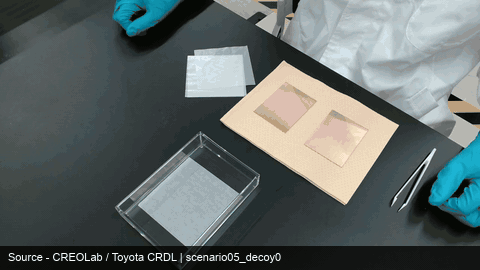
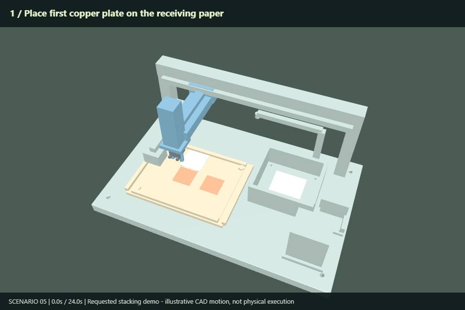
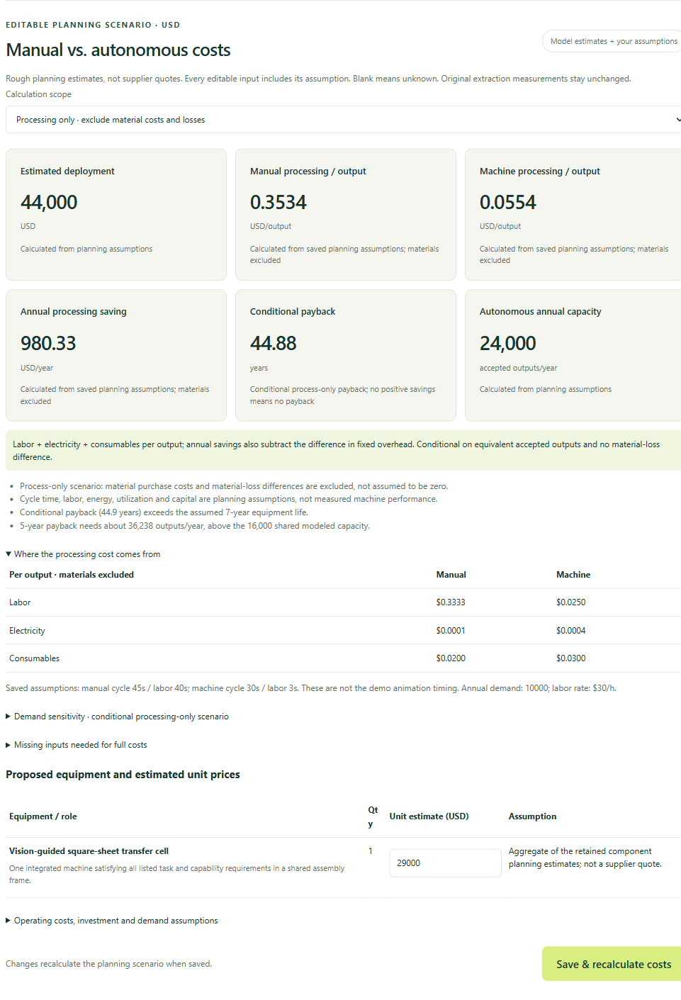

# Human Procedure → Machine Procedure

## Demo: video in → one integrated machine out

| Input video · researcher procedure | Output example · integrated-machine animation |
| --- | --- |
| [](docs/media/scenario05-input.mp4) | [](docs/media/stacking-output.mp4) |
| **[Watch input MP4](docs/media/scenario05-input.mp4)** · **[Download input GIF](docs/media/scenario05-input.gif)** · 17.6 seconds | **[Watch output MP4](docs/media/stacking-output.mp4)** · **[Download GIF](docs/media/stacking-output.gif)** · 24 seconds |

**Input footage credit:** [CREOLab — Toyota Central R&D Labs., Inc. (Toyota CRDL)](https://github.com/ToyotaCRDL/CREOLab#dataset), clip `scenario05_decoy0.mp4`. The input GIF preserves the full clip at reduced resolution/frame rate and adds an attribution banner. Original footage is not our work; upstream noncommercial research terms apply.

**The output demo:** place a copper plate on the receiving paper, pick a paper separator
from the visible paper supply and place it on the copper, then add the second copper
plate. Final stack: **paper → copper → paper → copper**.

The machine is one shared-base assembly with **12 named CAD bodies**, designed against
**11 task/capability requirements**. Its static CAD envelope is **1.100 × 0.700 × 0.445 m**,
with a **0.77 m²** footprint. The workflow is available in the original workbench:
Video → Models → Analysis → Results → Design → Machine → Scene & lab.

**Provenance:** the input is CREOLab `scenario05_decoy0.mp4` ([upstream dataset](https://github.com/ToyotaCRDL/CREOLab#dataset), noncommercial research terms).
The output is a **user-directed stacking demonstration**, using live-model-authored CAD
with recorded local geometry/placement refinements and authored animation. It is not
an unedited automatic reconstruction, physical execution, or a measured 24-second machine cycle.

### Sample prices and processing-cost scenario

These are **saved model planning assumptions—not supplier quotes or measured costs**.
The component allowances were carried forward into the integrated design and need
re-costing for a final bill of materials.

| Datapoint | Sample value | Scope |
| --- | ---: | --- |
| Equipment allowance | **$29,000** | Aggregate component estimate for one workcell |
| Installation | **$2,000** | Assumed deployment allowance |
| Engineering integration | **$12,000** | Assumed tooling, vision and programming work |
| Training | **$1,000** | Assumed setup/training allowance |
| Total estimated deployment | **$44,000** | Equipment + installation + integration + training |
| Manual processing cost | **$0.3534/output** | Labor + electricity + consumables; materials excluded |
| Machine processing cost | **$0.0554/output** | Same processing-only scope |
| Annual processing saving | **$980.33/year** | At 10,000 outputs/year, after fixed-overhead difference |
| Conditional simple payback | **44.88 years** | Exceeds the assumed seven-year equipment life |

This scenario assumes **$30/hour labor**, **40 seconds manual labor vs. 3 seconds machine
attendance per output**, and **$500 vs. $2,500 annual fixed overhead**. Material prices,
loss differences and equivalent accepted outputs remain unverified; full costs stay
unknown. The sample assumptions do **not** establish an attractive ROI. The requested
stacking sequence needs its own measured operating baseline before an investment decision.

<details>
<summary>View the sample pricing dashboard</summary>



</details>

---

## How to run

### 1. Install

Use **Python 3.11+** and install **FFmpeg / FFprobe** on your PATH. Run these commands
from a terminal:

```bash
git clone https://github.com/isayahc/Real-Time-Video-Agents-Hack-NYC.git
cd Real-Time-Video-Agents-Hack-NYC
git checkout nebius-continuation
python -m pip install -e ".[e2e,design,test]"
python -m playwright install chromium
```

Native CAD and 3D rendering additionally require **Node.js 22+**, **OpenCode CLI**,
and compatible **Forma** and **OpenIndustries** checkouts. Install OpenIndustries'
npm dependencies in its checkout and use Forma's managed CAD setup:

```bash
npm install -g opencode-ai
npm --prefix "/path/to/OpenIndustries" install
python "/path/to/forma-oss/.agents/skills/forma-hardware/scripts/cad.py" setup
```

Replace the example paths with your local checkout locations. Existing sibling
`forma-oss` and `OpenIndustries` directories are detected automatically; otherwise
set `FORMA_ROOT` and `OPENINDUSTRIES_ROOT` in `.env`.

### 2. Configure model access

Create **`.env` in the repository root** (or edit your existing file):

```dotenv
NEBIUS_API_KEY=your_nebius_key
GMI_API_KEY=your_gmi_key
# Optional if the native checkouts are not sibling directories:
# FORMA_ROOT=/absolute/path/to/forma-oss
# OPENINDUSTRIES_ROOT=/absolute/path/to/OpenIndustries
```

Keys stay on the server. The scripted live pipeline uses Nebius for vision and
GMI/GPT-6 Astra for text and CAD authoring; account access is required. Restart the
server after changing `.env`. See [native setup and troubleshooting](docs/scripted-e2e.md#setup-once)
for adapter paths, Windows configuration and dependency checks.

### 3. Open the workbench

```bash
python -m protocol_pipeline.web
```

Open **[http://127.0.0.1:8000](http://127.0.0.1:8000)**. Select a video, choose models,
and follow **Video → Models → Analysis → Results → Design → Machine → Scene & lab**.
On Windows, `run-workbench.cmd` starts the workbench with automatic reload.

**To show saved results without fresh model calls:** expand **Import snapshot ·
populate this workbench**, then upload a full snapshot ZIP or enter its local path.
For example, `snapshots/workbench-20261022-184138Z-a90ec05/snapshot.zip` is the committed
historical snapshot. It contains the earlier component-based example, not the newer
integrated stacking demo. Importing preserves available stages; it does not generate
missing outputs. The latest input/output demo media is available above without setup.

### 4. Run the full pipeline from the command line

```bash
# Check native dependencies, browser rendering and account model catalogs first.
python scripts/run_e2e.py --check

# Make fresh live requests using the included example video.
python scripts/run_e2e.py --video docs/media/scenario05-input.mp4
```

Each live run writes a new version under **`snapshots/e2e/vNNNNNN/`**, retaining
results and failure diagnostics. Live runs incur provider usage and may need model
corrections; they are distinct from opening a saved snapshot in the UI. The specific
stacking GIF above is an authored demonstration, not a promise that a fresh run will
reproduce the identical geometry or animation. See [the scripted E2E guide](docs/scripted-e2e.md).

### GPU inference with static Vercel playback

The [GPU-run replay exporter](docs/gpu-inference-static-replay.md) packages selected
recordings, frames, model provenance and checksummed action/controller artifacts
for a static Vercel viewer. A [recorded local diagnostic](https://mapped-assembly-judge-demo.vercel.app/humanoid/index.html)
ran one GR00T action chunk through SONIC in MuJoCo: **40 steps / 0.8 simulated
seconds; task success not evaluated**. The included example receipt preserves the
earlier blocked preflight. Exporting or viewing a snapshot makes no inference calls.

### Tests

```bash
python -m pytest -q
```

Enable real native CAD/browser integration tests in **PowerShell**:

```powershell
$env:WORKBENCH_NATIVE_E2E_TESTS = '1'
$env:WORKBENCH_NATIVE_CAD_TESTS = '1'
python -m pytest -q
```

Or on **macOS/Linux**:

```bash
WORKBENCH_NATIVE_E2E_TESTS=1 WORKBENCH_NATIVE_CAD_TESTS=1 python -m pytest -q
```

The native integration tests use deterministic model fixtures; they do not establish
live provider availability or physical machine performance.

---

Evidence-grounded CREOLab video ingestion and Nebius-assisted protocol/apparatus planning. Existing designs and estimates remain in [snapshots/v1](snapshots/v1/) and [snapshots/v2](snapshots/v2/); the [Nebius epic](https://github.com/isayahc/Real-Time-Video-Agents-Hack-NYC/issues/16) tracks the broader product.

## What the implemented pipeline does

**Current milestone:** [live BridgeData pipeline evidence and offline lab continuation](docs/bridgedata-small-sample.md).
**Next mission gate:** [decision-proof roadmap and full-workflow measurement intake](docs/decision-proof-roadmap.md).
**Dataset-backed baseline:** [ten HA4M manual assembly trials](docs/ha4m-small-sample.md),
with complete action annotations and sparse RGB previews; recorded time allocations
are established, while accepted-output quality and intervention savings remain unknown.
The resource/investment/alternatives evaluators already exist; actual baseline
measurements and accepted-output equivalence remain unresolved. Offline collection
templates now connect sourced batch records to those evaluators without treating
unknown labor or incomplete workflow coverage as zero.

For automated video-to-CAD-to-lab runs with the requested Nebius/GMI models, use [the E2E snapshot runner](docs/scripted-e2e.md). `python scripts/run_e2e.py --snapshot <directory-or-zip>` runs every workbench stage and appends a checksummed version; subsequent invocations without input use the latest snapshot's video and settings.

1. Copies the original annotation bytes unchanged and normalizes CREOLab's `video_id`, objects, normalized first-frame positions, `caption`, and alternative `reference_procedure` string/list.
2. Uses ffprobe decoded-frame presentation timestamps and ffmpeg sampling to retain real frame indices, timestamps and SHA-256 hashes.
3. Sends sampled pixels/timestamps to a selected Nebius vision model. Procedure ground truth is never included. Optional object hints are explicitly annotated first-frame positions, not tracks.
4. Validates the returned object/action/state graph against the sampled frames and timeline.
5. Calls an explicitly selected NVIDIA model through Nebius Token Factory to derive embodiment-independent operations and capabilities. Capabilities reference operations; operations reference source actions; actions reference video frames.
6. Stores possible off-camera preparation separately as unverified candidates. Numerical parameters, costs, labor, power and byproducts require separate sourced engineering inputs; unknowns stay null.
7. Exports typed apparatus requirements consumed by the Forma/OpenIndustries build command. Plant simulation and automatic cost/resource adapters remain subsequent integrations; the local evaluator accepts separately supplied resource/cost inputs.

This is sampled-frame visual reasoning, not continuous YOLO tracking, measured motion/force, physical validation or proof of experiment success. Merely naming a tool does not establish its function. Vision and compiler models are preset; availability still depends on your account. See [model presets and NVIDIA verification](docs/nebius-model-presets.md). The demo above includes live video extraction and live-model CAD authoring with retained corrections; it does not establish general extraction accuracy or physical feasibility. Tests also exercise deterministic contracts and native integration.

## Sample protocol videos

Use these examples to choose a procedure for the [video workbench](#video-workbench).
The Addgene links come from its [official video library](https://www.addgene.org/protocols/videos/).

| Sample | Watch / obtain | Suggested review focus |
| --- | --- | --- |
| Multichannel pipetting — Addgene | [Watch video](https://youtu.be/uFzlUT8b_XQ) | Repeated liquid transfers and pipette handling. |
| Aseptic technique — Addgene | [Watch video](https://youtu.be/wttvhJU9PZM) | Workspace preparation, equipment handling and visible preparation steps. |
| Pouring LB agar plates — Addgene | [Watch video](https://youtu.be/ey19jM6y7-c) · [Written protocol](https://www.addgene.org/protocols/pouring-lb-agar-plates/) | Material preparation, pouring and ordering of operations. |
| Agarose gel electrophoresis — Addgene | [Watch video](https://youtu.be/TIZRGt3YAug) · [Written protocol](https://www.addgene.org/protocols/gel-electrophoresis/) | A longer procedure with multiple tools and apparatus stages. |
| CREOLab experimental procedures — Toyota CRDL | [Dataset and download instructions](https://github.com/ToyotaCRDL/CREOLab#dataset) | Laboratory tool use with paired video/annotation files for the existing ingestion workflow. |

**Try a sample:** obtain a permitted local copy, start the workbench using the instructions
[below](#video-workbench), and select an MP4, WebM or MOV file up to 100 MiB. Prefer a short,
continuous procedure segment and H.264 MP4 or WebM for browser playback. The workbench
uploads local files; it does not import YouTube or other webpage URLs.

For the annotation-based CLI example below, use a CREOLab video and its matching JSON
annotation (for example, `scenario01_decoy0.mp4` and `scenario01_decoy0.json`).
The linked Addgene tutorials do not come with this project's annotation format.
Follow each source's usage terms; CREOLab is limited to noncommercial research.
Keep downloaded media under the ignored `data/` directory.

These are suggested evaluation inputs, not completed live-inference benchmarks. Review
the actual clip and its evidence timestamps before treating extracted steps as verified.

## Install and ingest

Requires Python 3.11+, ffmpeg and ffprobe. On WSL2/Ubuntu, `sudo apt install ffmpeg` supplies both binaries.

```bash
python -m pip install -e .
python -m protocol_pipeline ingest \
  --video /path/to/data/videos/scenario01_decoy0.mp4 \
  --annotation /path/to/data/captions/scenario01_decoy0.json \
  --output runs/t1-001 --frames 8
```

Ingestion is local and makes no model calls. It refuses an existing output directory and mismatched video/annotation take filenames. The demo clip above is included as an example; obtain additional authorized data from the [upstream dataset](https://github.com/ToyotaCRDL/CREOLab). Its source license limits dataset/code use to noncommercial research.

## Live analysis

Set `NEBIUS_API_KEY` (or `NEBIUS_TOKEN_FACTORY_KEY`) through your environment. The built-in presets are `MiniMaxAI/MiniMax-M3` for vision and `nvidia/Nemotron-3_5-Lightning` for compilation/design. Environment settings and explicit model flags remain available as overrides. The API URL is `https://api.tokenfactory.nebius.com/v1/chat/completions`.

```bash
python -m protocol_pipeline analyze \
  --run runs/t1-001
```

Add `--annotation-grounding` deliberately to supply source object labels/first-frame positions. This is an assisted-annotation evaluation mode; compare it separately from the default video-only mode. Both exclude procedure ground truth. API/model requests incur provider usage. Transient HTTP retries are bounded to three attempts; a retry may incur additional usage. Authentication headers are never written to traces. Inference refuses existing successful/partial observation outputs; ingest another run for another attempt.

Outputs are JSON-validated without repairing malformed responses. Empty observations are allowed when evidence is insufficient. Temporal intervals are inferred from sparse images; valid references are necessary, but not sufficient, to establish semantic accuracy.

## Output separation

| Artifact | Meaning |
| --- | --- |
| `ground-truth.original.json` | Exact source bytes, including unknown upstream fields. |
| `ground-truth.normalized.json` | Normalized source procedure/objects for later evaluation. |
| `annotation-object-catalog.json` | Optional first-frame object hints; no procedure text. |
| `frames/`, `manifest.json` | Actual sampled pixels, source PTS/frame indices and hashes. |
| `observations.json` | Model-inferred objects, actions and changes with evidence/confidence. |
| `protocol-plan.json` | Derived operations, apparatus capabilities, preprocessing hypotheses and unknowns. |
| `engineering-inputs.json` | Separately supplied specifications, assumptions and measurements. |
| `apparatus-request.json` | Typed requirements handoff; submit through the build command. |
| `*-provider-trace.json` | Requested/served model, response, token usage and latency. |

## Engineering inputs

Pass a JSON file to ingestion with `--engineering-inputs`. Each category (`parameters`, `costs`, `labor`, `power`, `byproducts`) is a dictionary of explicit values:

```json
{
  "parameters": {
    "wire_diameter": {"value": null, "unit": "mm", "basis": "unknown"}
  },
  "power": {
    "active_input": {"value": 30, "unit": "W", "basis": "assumed", "source": "Illustrative v2 scenario; not measured"}
  }
}
```

Unknown values cannot be numeric zero; non-unknown values require a source description. The pipeline does not turn inferred video descriptions into numerical engineering data. Preprocessing candidates do not receive invented durations or become confirmed annotations.

## Checks

```bash
python -m unittest discover -s tests -v
```

Tests check broken frame/operation references, temporal inconsistency, numerical provenance, annotation alternatives/raw-byte preservation, actual ffmpeg source timestamps, and exclusion of ground truth from both request modes. They do not claim live provider success or scientific validity.

Keep downloaded data, runtime frames, annotations and provider outputs outside Git; `.gitignore` excludes `data/` and `runs/`. The chosen T1 scenario already guided our design and is not an untouched held-out benchmark. Select a distinct procedure for held-out evaluation.

## Full manual baseline

The [coil-winding benchmark](benchmarks/coil-winding/) defines the full manual workflow, human labor/resource boundary, acceptance gates and an event-level measurement template for [epic #17](https://github.com/isayahc/Real-Time-Video-Agents-Hack-NYC/issues/17). Its metrics remain unknown until a reviewed full run is recorded; existing snapshot estimates are not measured baseline values.

## Process evaluation

The [deterministic evaluator](examples/process-evaluation/) calculates recurring cost, labor, energy and material/waste quantities per accepted output from sourced batch inputs. Unknown inputs remain null; operator attendance overlaps are merged; reports preserve inputs and assumptions. Investment comparison is implemented separately below; the iteration controller is implemented below.

```bash
python -m protocol_pipeline evaluate \
  --input examples/process-evaluation/coil-v2-partial.json \
  --output /tmp/coil-process-report.json
```

## Infrastructure investment comparison

The [investment comparator](examples/investment-comparison/) evaluates manual versus apparatus operating costs, upfront deployment, annual capacity, simple payback and horizon break-even demand, including sourced sensitivity cases. Output equivalence, missing inputs, insufficient capacity and unmodeled replacements block a cost decision.

```bash
python -m protocol_pipeline compare \
  --input examples/investment-comparison/synthetic-comparison.json \
  --output /tmp/investment-report.json
```

## Versioned iteration loop

The [iteration controller](examples/iteration-loop/) records predictions, attaches evidence-labeled outcomes, flags deviations and reevaluates explicit revision proposals through process and investment accounting. Records are append-only with hashed lineage; illustrative runs remain distinguished from physical/simulation evidence. The build command links Forma/OpenIndustries artifacts to a prediction/revision and carries proposed changes into synthesis; physical data collection remains separate.

## Apparatus and scene build

The [design adapter](examples/design-handoff/) calls Forma Core and OpenIndustries native import/export plus local MCP room tools, with explicit live/simulation/replay modes. It records validation, source-prediction lineage and artifact hashes. Local simulation and CW-02 replay integration were verified; live generation still needs provider configuration.

## Single-command demo

The [demo runner and executed sample report](examples/demo/) run the illustrative feedback loop and replay CW-02 into a native scene, producing HTML, Markdown and structured results with explicit evidence labels.

```bash
python -m protocol_pipeline demo \
  --output runs/demo-001 \
  --forma-root /path/to/forma-oss --oi-root /path/to/open-industries
```

Use `--accounting-only` to explicitly skip optional scene runtimes. Both modes preserve unknown coil economics and existing records.

## Offline coil protocol workflow

Run the fixed CW-02 protocol through candidate apparatus requirements and resource accounting without credits:

```bash
python -m protocol_pipeline coil-offline --output runs/coil-offline-001
```

See the [executed report and measurement workflow](examples/coil-offline/README.md). Full-process measurements remain unknown; winding-only estimates are reported separately.

## Apparatus alternatives

Compare manual, simple motorized and CW-02 candidate architectures without model calls:

```bash
python -m protocol_pipeline compare-alternatives \
  --input examples/apparatus-alternatives/illustrative-input.json \
  --output runs/apparatus-illustrative-001
```

The [comparison](examples/apparatus-alternatives/README.md) includes a separate current-evidence report with unknown full-process values and explicitly hypothetical volume/labor scenarios. It exposes tradeoffs without declaring verified savings or a procurement recommendation.

## Offline verification and failure replay

```bash
python -m protocol_pipeline failure-replay --output runs/failure-replay-001
python -m scripts.verify_offline --output runs/ci-offline-001
```

The [failure scenarios](examples/failure-replay/README.md) distinguish explicitly skipped steps from missing evidence and exercise delays/rejects through the resource evaluator. GitHub Actions runs tests and all offline workflows on Python 3.11/3.12 and retains the reports as artifacts. Application stages require no provider credits or keys.

## Reusable protocol input

```bash
python -m protocol_pipeline compile-protocol \
  --input examples/protocols/tube-transfer.json --output runs/compiled-transfer-001
```

The [shared protocol format](examples/protocols/README.md) compiles both coil winding and conceptual empty-tube transfer into the same apparatus and resource contracts. Inputs explicitly supply operations, dependencies, candidate equipment, preparation and acceptance checks; no task-specific inference or physical measurements are invented.

## Automatic extraction providers

```bash
python -m protocol_pipeline extract-protocol \
  --text /path/to/procedure.txt --provider nebius \
  --output runs/text-extraction-001
```

[Extraction](examples/extraction/README.md) supports text and sampled-video input, explicit Nebius model selection, source-grounding checks, and direct compiler handoff. A separate recorded-response replay exercises the integration without credits. A live Nebius text-to-compiled-plan smoke test passed on 2026-10-19; extraction accuracy, live video inference and physical validation remain unverified.

## Extraction accuracy review

The [SO-101 seed-placement benchmark](examples/so101-benchmark/README.md) freezes
typed trial inputs, matched-comparison boundaries and separate simulation/physical
acceptance. Its checked-in fixture is assumption-only; validation reports missing
runtime artifacts and unknown physical measurements without claiming robot results.

The [SO-101 robot contract](examples/so101-robot/README.md) loads the pinned upstream
follower URDF and meshes, checks joint limits/TCP transforms, aligns a reference
attachment and exports the same geometry for OpenCAD/Forma and native OI import.
Its virtual mount and source-model values do not establish physical tool fit or payload.

The [benchmark workflow](examples/extraction-benchmark/README.md) scores step coverage, ordering, reviewer-assessed grounding, preparation/evidence classification and acceptance checks against a source-bound reference. No review means pending scores. The initial authored text fixture verifies scoring behavior; it does not establish live Nebius quality.


## Video workbench

Watch an uploaded procedure video while the Python pipeline analyzes sampled frames,
then inspect operations and click evidence timestamps to seek the player. The workbench
includes persisted run history, real stage progress, apparatus/resource views, reports,
and a source/evidence ZIP with SHA-256 checksums.

```bash
python -m pip install -e ".[web,test]"
# Install ffmpeg using your system package manager if not already installed.
# Set NEBIUS_API_KEY (or NEBIUS_TOKEN_FACTORY_KEY) in the server environment.
python -m protocol_pipeline.web
```

Open http://127.0.0.1:8000. Choose an MP4, WebM or MOV (up to 100 MiB), keep the preset models or choose available overrides, then select **Start analysis**.
Use **Use recommended models** to restore the presets after an earlier saved choice.
For broad browser playback compatibility, use H.264 MP4 or WebM. Model keys never
need to be entered in the browser. No inference runs until you submit a video.

Run one server process; this is a local trusted-user workbench, not a public or
multi-user service. Uploads and outputs remain under `runs/workbench/`. Restarting
preserves completed runs and marks unfinished jobs failed instead of retrying paid
calls automatically. Up to four uploads/jobs are admitted and inference is serialized.
Use `--runs PATH` and `--port PORT` to customize local storage and port.

See [the issue #26 verification and demo guide](docs/video-workbench.md) for evidence
export, live verification, semantic review and remaining requirements.

| Capability | Verification status |
| --- | --- |
| Video upload, real decoding, stage events, compilation, artifact API, byte-range media, evidence ZIP | Automated HTTP integration tests using explicitly synthetic replay inference |
| Browser controls, side-by-side results, evidence seeking | Implemented; manual browser verification pending |
| Direct Nebius live text extraction | Historical smoke test documented in #25; not rerun for this change |
| Live video inference and semantic accuracy | Pending credentials, selected source video and human reference/review |
| OpenCode extraction | Mock-tested local correction and error handling; live structured-output compatibility unresolved |
| Scene generation and physical performance | Not verified by this milestone |

## License

Project source code is licensed under the [Mozilla Public License 2.0 (MPL-2.0)](LICENSE).
Modifications to covered files distributed outside your organization must remain
available under MPL-2.0; separate files containing no MPL-covered code may use other licenses.

This license does not relicense third-party dependencies, external videos, datasets,
model weights, or other third-party assets. Their respective licenses and attribution
requirements continue to apply. In particular, the CREOLab restrictions and source
links documented above remain applicable. See [issue #44](https://github.com/isayahc/Real-Time-Video-Agents-Hack-NYC/issues/44)
for the separate asset-permissions and attribution review.

The [SO-101 seed-presentation fixture](examples/so101-fixture/README.md) builds a real
parametric OpenCAD candidate, exports STEP/STL and interface transforms, and verifies
fit to the frozen ideal seed target while preserving the robot geometry.

The [executed SO-101 simulation baseline](examples/so101-simulation/README.md) connects PyBullet motor/contact trials to native OI replay, with deterministic resets, observed failures, trajectories and videos. It is simulation evidence, not successful planting or physical validation.

The [matched SO-101 tooling comparison](examples/so101-comparison/README.md) diagnoses the virtual-TCP/closure mismatch and compares a reference pocket with the OpenCAD seat under shared corrected controls. Failed attempts, resource unknowns and evidence hashes feed the existing accounting contract; no winner is inferred.

The [Nebius Serverless Job setup](deploy/nebius/README.md) packages that comparison,
video generation and OI evidence checks in a CPU container, with results and failure
logs copied to a mounted output volume. Cloud execution requires a published image
and configured Nebius project; the container configuration alone is not live proof.
