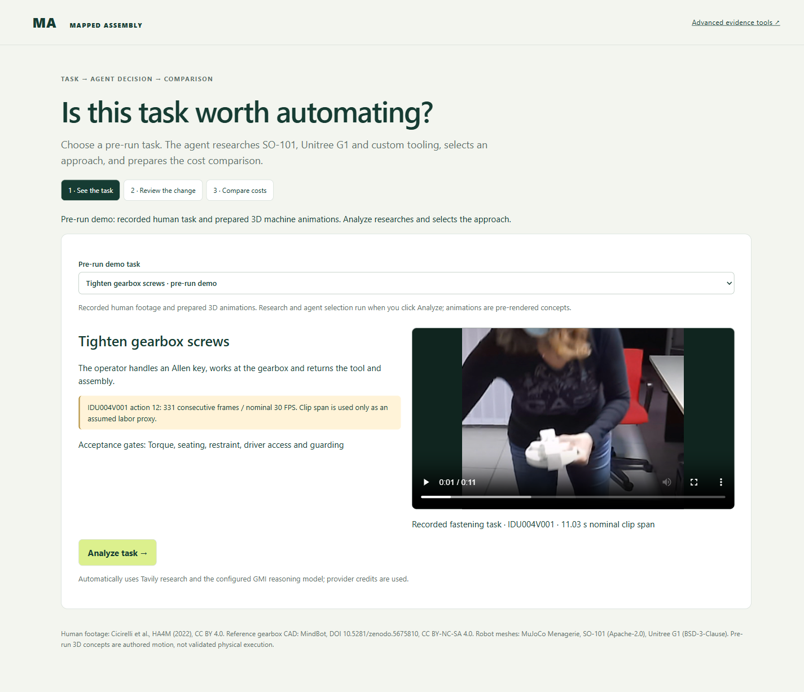
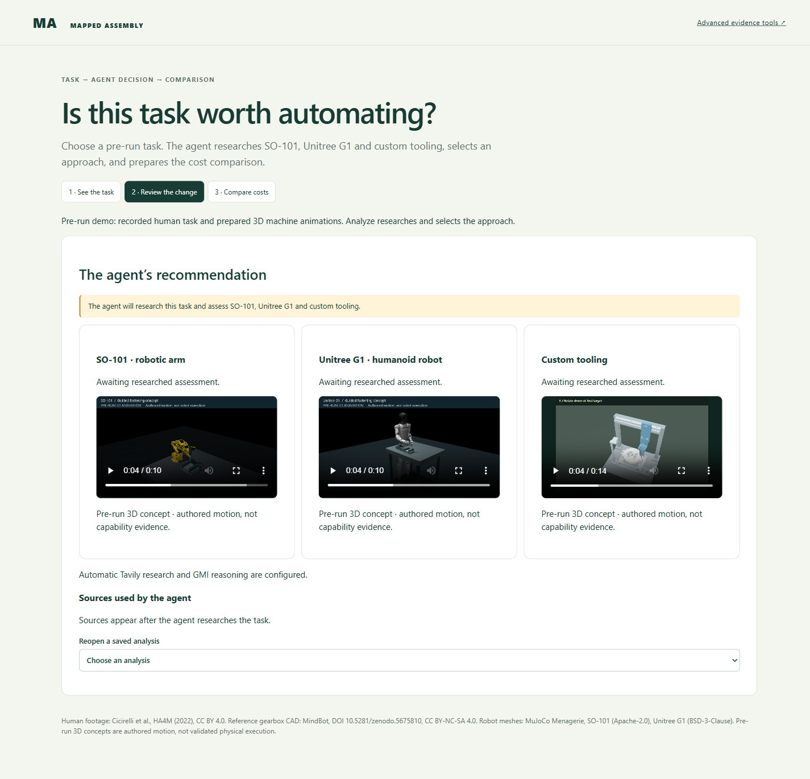
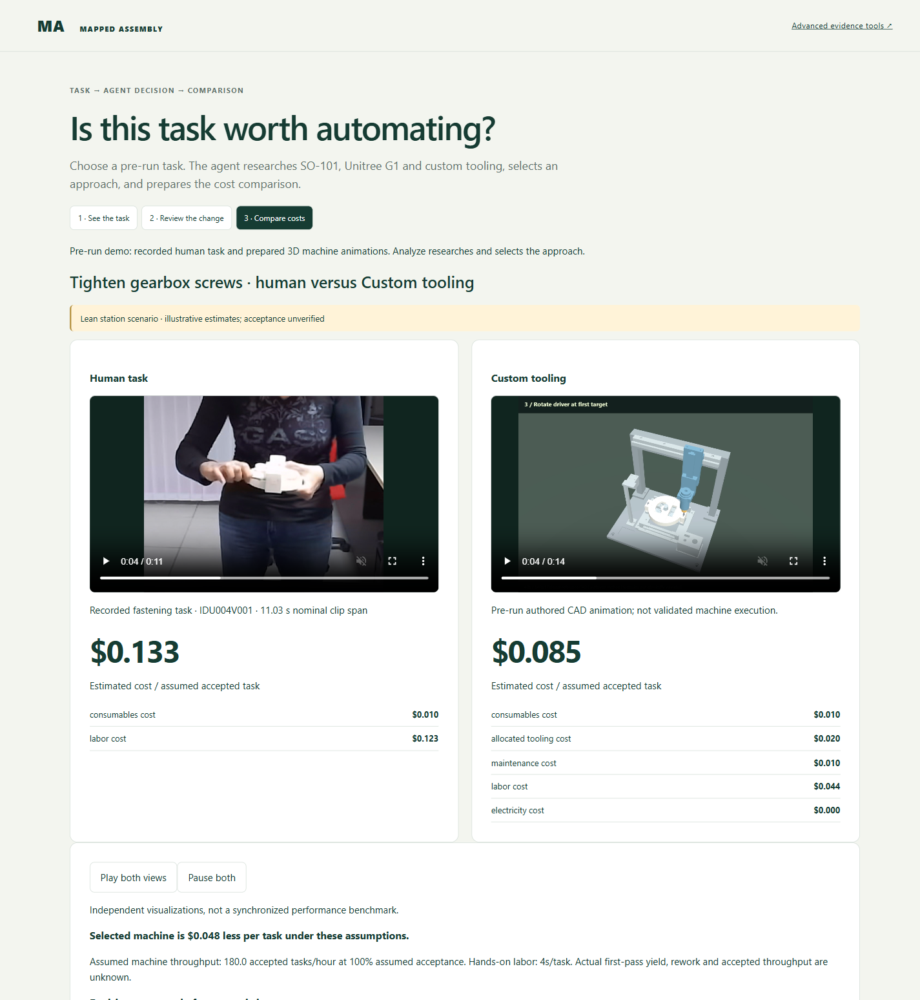

# Main user flow: task → agent decision → cost comparison

The workspace is a three-step, no-typing walkthrough for reviewing a proposed
process improvement. The user chooses a prepared task and starts analysis; the
agent researches and assesses **SO-101**, **Unitree G1** and **custom tooling**.

> **About these screenshots:** captured from the real local UI on October 30, 2026,
> after PR #79. Steps 1 and 2 show the current interface before analysis. Step 3
> reopens a historical saved fastening comparison. This is a visual walkthrough,
> **not evidence of a newly completed end-to-end agent run**. No paid research or
> inference calls were made to produce this guide.

## Open the workspace

```sh
python -m protocol_pipeline.web --port 8023 --runs runs/process-workspace-local
```

Visit **http://127.0.0.1:8023/**. For a new analysis, the server needs
`TAVILY_API_KEY` and `GMI_API_KEY`. `GMI_MODEL` optionally overrides the configured
reasoning-model default. Keep credentials server-side in the supported environment
or ignored `.env`.

The prepared human clips, CAD animations and robot renders are **local assets**,
not bundled with a fresh clone. See [the workspace setup and delivery
limitations](process-workspace.md#current-delivery-limitations) before trying to
reproduce the screenshots.

## 1. See the task



1. Keep **Tighten gearbox screws · pre-run demo**, or choose
   **Place a planet gear · pre-run demo**.
2. Watch the recorded human task. Read the task boundary, timing source and
   unresolved acceptance requirements.
3. Click **Analyze task →** to begin automatic research and reasoning.

“Pre-run demo” means the human footage and machine concept animations are already
prepared. It does **not** mean a fresh agent decision has already been computed.
Recorded clip duration is not a measured full-process cycle or labor requirement.

## 2. Review the change



The three cards are candidates for the agent to assess, not manual equipment
selection controls:

| Candidate | What the preview shows |
| --- | --- |
| **SO-101 · robotic arm** | Original robot meshes with authored task motion. |
| **Unitree G1 · humanoid robot** | Original robot meshes with authored task motion. |
| **Custom tooling** | An existing task-matched authored CAD concept. |

After **Analyze task**, the backend:

1. Searches with **Tavily** automatically.
2. Sends the task, research evidence and planning allowances to the **GMI reasoning agent**.
3. Validates an assessment of all three candidates, a selected intervention and
   planning profile, rationale, unresolved gates and references to supplied sources.
4. Computes the conditional estimate, attaches the matching prepared animation,
   and saves the result.

The completed screen exposes the recommendation and research sources, followed by
**See the side-by-side comparison →**. There is no research opt-out or manual
robot/profile picker. Research and inference use provider credits.

**Screenshot state:** this capture deliberately shows **Awaiting researched
assessment**. Opening tab 2 alone does not initiate analysis, and the picture does
not show a completed agent recommendation. Animations demonstrate proposed motion,
not proven gripping, fastening, collision clearance, balance or task success.

## 3. Compare costs



The comparison brings together:

- **Left:** the human task, estimated cost and cost components.
- **Right:** the selected machine concept, estimated cost and cost components.
- **Play both views / Pause both:** paired viewing, not synchronized performance measurement.
- **Below the pictured area:** next measurements, research sources, assumptions,
  limitations and **Download decision & evidence**.

**This screenshot is a historical replay**, opened through **Reopen a saved
analysis** using snapshot `7dd7a47e9f2f4f06b6e7bb573d2cdc96`. It predates automatic
agent selection and uses the earlier lean station scenario: **$0.133 human versus
$0.085 custom tooling per assumed accepted task**. Five saved Tavily sources are
available in that record. These values are illustrative assumptions, not current
quotes, measured savings, or the result of a new agent run.

Actual accepted throughput, first-pass yield, rework and physical performance remain
unknown. Animation playback length is not the machine-cycle input. Read the
assumptions and excluded costs before using a comparison to make a decision.

## Reopen and export

In step 2, **Reopen a saved analysis** loads an existing record without new research
or inference. On the comparison screen, **Download decision & evidence** exports
the saved report, machine-readable analysis and checksum manifest. The export does
not bundle all referenced video files.

The **Advanced evidence tools** link opens the existing video/design workspace at
`/video`. The broader editable process-review prototype remains at `/process-review`.

## Why tab 3 may not open

- Tab 3 needs a completed analysis or a successfully reopened saved comparison.
- Clicking tab 2 alone only opens the review screen. Start with **Analyze task**
  in step 1, or reopen a saved result.
- During the current synchronous analysis request, **all buttons are disabled**
  while Tavily and the reasoning agent run. There is no granular progress display
  or cancellation control yet. Pre-rendered animation generation is not running
  during this wait.
- If research, reasoning or animation attachment fails, the UI shows an error and
  retains the failed record. It does not replace the agent with a preset choice.

This guide documents the existing navigation limitation; it does not fix it.

## Capture evidence and attribution

See [capture notes and attribution](media/main-user-flow/README.md) for the viewport,
exact captured states, browser checks and media sources.
