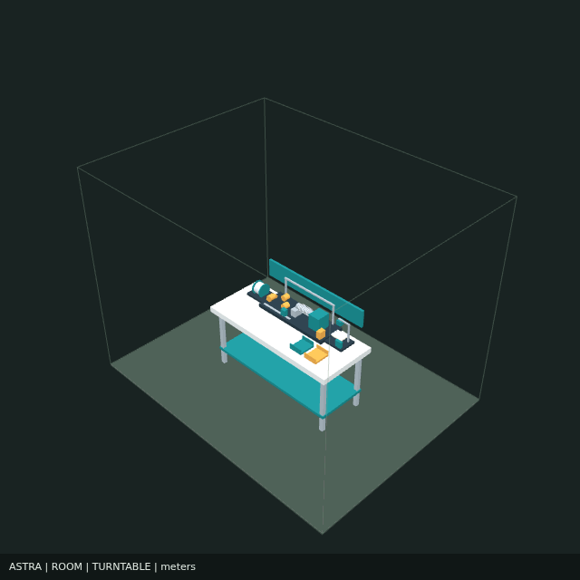

# CW-02 — integrated two-axis coil-winding apparatus

This v2 snapshot preserves the original estimates and proposed apparatus. [V1 baseline](../v1/README.md) remains unchanged.

## Intended result and equivalence

Reproduce the published CREOLab T1 transformation: straight platinum wire becomes a helix. The actual annotation/video and engineering specifications are not yet ingested. Geometry equivalence must be checked on the released coil; chemical/electrode performance is outside this geometric demonstration.

## Apparatus

One benchtop cell contains a supply spool, adjustable friction brake and dancer/tension guide, removable mandrel and spindle, winding motor, second motor driving a lead-screw traverse guide, tension sensing, controller, camera/backlight, and separate accepted/scrap trays. Human actions are threading/clamping, cutting and coil removal. The concept uses two powered axes; the spool/feed is passive.

The traverse travels one selected pitch for each spindle revolution. The motor stops at the target turn count. The operator cuts the leads and removes the mandrel or slides off the coil, then the camera checks the released geometry. Split/tapered mandrel details and springback compensation require trials. The winding zone requires a guard/stop arrangement before construction.

## Explicit illustrative specification

- Wire: 0.254 mm platinum; density reference 21.45 g/cm³. Temper and surface requirements unresolved.
- Mandrel: 3.0 mm diameter; target ten turns, 0.35 mm axial advance/revolution.
- Retained lead length: 20 mm total; trim: 5 mm per attempt.
- Cycle: 30 seconds, including 15 seconds powered/inspection and 15 seconds reduced-power handling.
- Reject fraction: assumed 5%; operator touch: assumed 15 seconds/attempt.

These are scenario inputs, not dataset measurements. Released diameter differs from mandrel diameter through springback. No acceptance tolerances are invented. Camera resolution, calibration, and suitable close-focus optics must be established. The visualization is schematic and its coil/mandrel meshes are not fabrication dimensions.

## Power and energy

Budget 25–40 W active at the wall, 5–12 W with motor drivers released. The nominal scenario uses 30 W active and 8 W handling-idle. Two candidate motors have 35 ohm windings and 0.35 A phase ratings; two phases per motor at full current give a copper-loss example of 17.15 W. That is a loss estimate, not measured input or shaft power. Computer/camera, lighting, control electronics and conversion losses account for the remaining budget.

Nominal: 0.158 Wh/attempt, 0.167 Wh/accepted coil at assumed 95% yield, and 0.152 kWh over eight continuously cycling hours. Power-budget sensitivity gives 0.132–0.228 Wh/accepted coil and 0.120–0.208 kWh/shift. Drivers must be released or reduced between cycles for this idle budget; holding current can erase that reduction. A 12 V 5 A power-supply rating is capacity, not a prediction of continuous 60 W consumption.

Excludes room HVAC/lighting, external computer services/cloud inference, and upstream wire production. Replace budgets with measured wall-meter data during validation. Gross scenario throughput is 120/hour and accepted throughput 114/hour; this ignores downtime, changeovers and operator interruptions.

## Material balance and byproducts

The helical centerline length per turn is sqrt((pi*(mandrel_diameter+wire_diameter))²+pitch²). With ten turns and retained leads, the retained wire length is 122.287 mm; input including trim is 127.287 mm. Input mass is 0.13835 g and retained mass 0.13291 g. Trim alone is 0.00543 g/attempt. With 5% whole-part rejects, total segregated scrap is 0.01208 g/attempt on expectation, or 8.73% of input. This is an assumed loss scenario, not a measured reject rate.

Byproducts are recoverable platinum offcuts, rejected coils, possible tool/roller wear debris, and heat dissipated by motors/electronics. No intentional chemical reaction, solvent effluent or process gas is designed into cold winding. Cleaning agents/lubricants, if introduced, require their own material/effluent accounting. Scrap is not assigned a recovery credit without actual collection/recovery terms.

At the prior supplier example of $272.80/m, wire purchase cost is $36.55 per accepted coil before scrap credit. This quantity/specification is illustrative and procurement pricing is not raw spot-metal value. Reducing trim and rejects could matter more than electricity in this scenario.

## Cost and human work

Forma's actual Pydantic Hardware IR schema and deterministic BOM derivation were used: 14 component instances, 12 BOM lines, midpoint $877.60. Five supplier-priced part types total $100.10 with the selected quantities; custom subsystems use explicitly labeled allowances. Apparatus budget: $535.10–$1,220.10, excluding bench, labor, material, tax/shipping and production qualification. One retail bench pricing proxy adds $119.99, giving $655.09–$1,340.09. Exact production components and custom fabrication remain unquoted.

No `compile_project` call, electrical rule validation or live model generation was performed. The IR's `is_valid` is false because engineering validation is outstanding; schema validity does not establish engineering validity.

At assumed 15 seconds touch per 30-second attempt, an eight-hour uninterrupted scenario consumes four hours of direct touch labor. This is neither staffing headcount nor a claim of four hours saved. Setup, supervision, maintenance, exceptions and the manual baseline are unmeasured. Labor per accepted coil is 15.79 seconds of touch time; multiply by a supplied loaded hourly rate and add other labor separately.

## Tradeoffs

| Choice | Benefit | Cost or limitation |
| --- | --- | --- |
| Hand crank + pitch fixture | Zero motor electricity; simple mechanics | Operator drives every cycle; repeatability/throughput require measurement. Inspection power is separate. |
| Two-axis cell (recommended first build) | Motorized turns and pitch; one integrated station | Human load/cut/unload; passive tension needs calibration. |
| Third powered feed axis / active tension | More direct feed/tension control | Additional actuator, sensors, power and control tuning; benefits must be measured. |
| Integrated inspection | Less station transfer and fewer benches | Shares equipment/cycle availability with winding; unsuitable optics could miss defects. |
| Separate inspection station | Allows buffering and independent inspection | Extra space, transfers, staffing/equipment and queue management. |
| Removable/tapered mandrel | Relatively simple release | Springback, handling damage and access affect yield. |

## Acceptance experiment

Obtain the actual target coil and wire specifications. Wind a small documented series across mandrel diameter, pitch and tension settings. Measure released diameter/pitch/turn count, breakage, surface damage, operator time, rejects, trim mass and wall power. Determine whether the two-axis option meets those criteria before adding powered feed or automatic handling.

## Files and verification

- `coil-winder.forma.json`: Forma-compatible project with BOM and schematic meshes; import into OpenIndustries.
- `coil-winder.oi.json`: portable single-apparatus scene, including its retained Forma project/BOM.
- `protocol.json`, `estimates.json`, `checks.json`: machine operation mapping, reproducible scenario and validation provenance.
- `estimate.py`: typed, documented calculation/IR authoring script. Run with the Forma checkout on PYTHONPATH.

Native OpenIndustries import/portable round trip passed with two instances and twelve retained BOM rows.

## Sources

- Task: https://github.com/ToyotaCRDL/CREOLab ; https://doi.org/10.1039/D5DD00542F
- Motor ratings: https://www.adafruit.com/product/324
- Driver: https://www.adafruit.com/product/6109
- Camera: https://www.adafruit.com/product/5657
- Pi power measurements (historical reference, workload dependent): https://www.raspberrypi.com/news/thermal-testing-raspberry-pi-4/
- Platinum density: https://www.goodfellow.com/global/platinum-spooled-wire-group
- Wire price example: https://buyplatinumwire.com/
